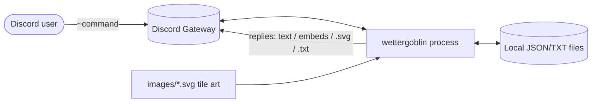
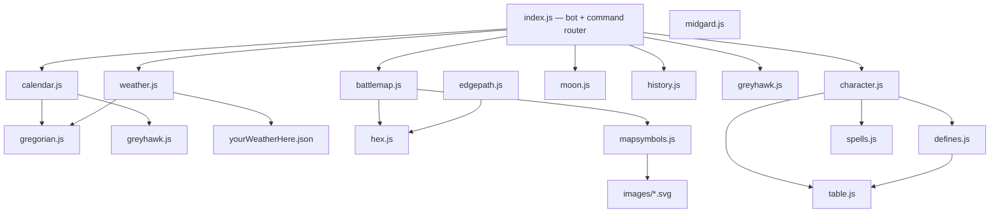
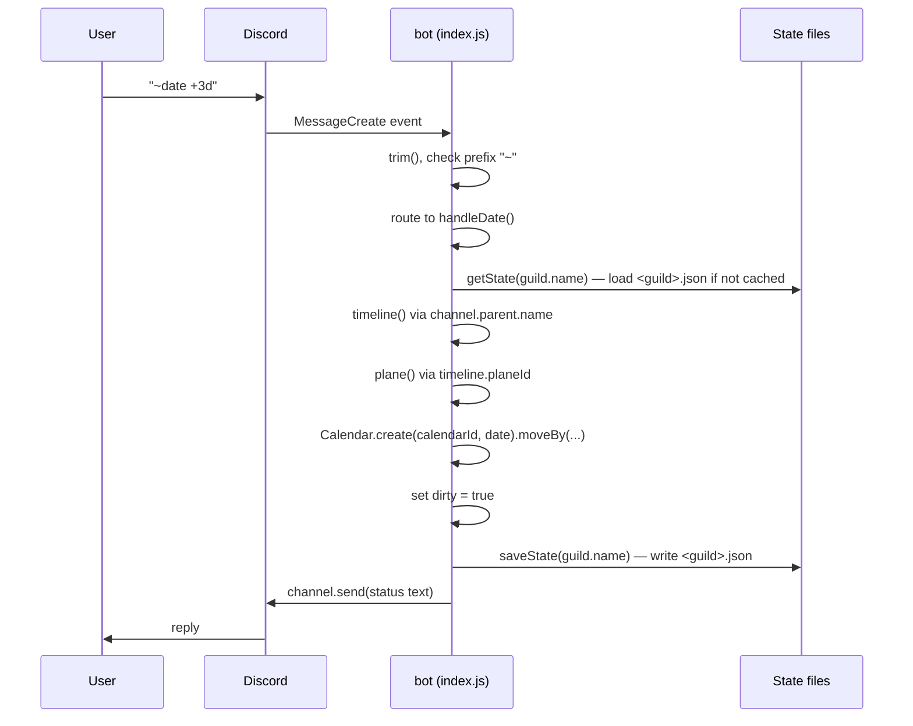
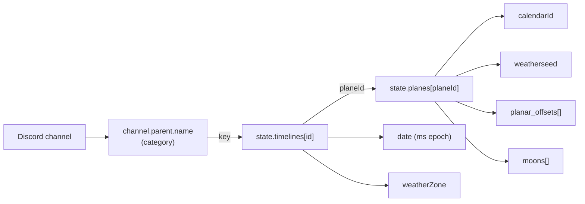

# Architecture Specification

## 1. System context

`wettergoblin` is a single-process Node.js application that connects to the
Discord Gateway as a bot user. It has no HTTP server, no database, and no
external API calls beyond the Discord connection. All persistent state lives in
flat JSON/text files in the working directory, named after the Discord guild.

- Inbound: `MessageCreate` gateway events (guild + DM intents enabled).
- Outbound: `channel.send()` with strings, `EmbedBuilder` embeds, or
  `AttachmentBuilder` file attachments.
- Storage: synchronous `fs` reads/writes, one file set per guild.

## 2. Module/component view

### Component responsibilities

| Module | Responsibility |
| --- | --- |
| [index.js](../../index.js) | Discord client, message routing, state load/save, all `handle*` command functions |
| [weather.js](../../weather.js) | Deterministic seeded weather value per date + season lookup into weather zone text |
| [calendar.js](../../calendar.js) | Factory choosing a calendar implementation by `calendarId` |
| [gregorian.js](../../gregorian.js) | Standard calendar backed by JS `Date` |
| [greyhawk.js](../../greyhawk.js) | Custom 364-day / 16-month Greyhawk calendar math |
| [moon.js](../../moon.js) | Moon phase → Discord emoji from cycle/offset days |
| [battlemap.js](../../battlemap.js) | Procedural 5×5 hex map, SVG rendering, rivers/roads/terrain |
| [hex.js](../../hex.js) | Hex cube/offset coordinate math and neighbor/turn logic |
| [mapsymbols.js](../../mapsymbols.js) | SVG tile fills/gradients and terrain icon loading from `images/` |
| [character.js](../../character.js) | AD&D-1e character generation and text/embed sheet rendering |
| [defines.js](../../defines.js) | Rules data: classes, races, requirements, hit dice, modifiers |
| [spells.js](../../spells.js) | Spell lists by class and level |
| [table.js](../../table.js) | Weighted random-selection table |
| [history.js](../../history.js) | Legacy/partial date-parsing helpers for the `weather` date |
| [edgepath.js](../../edgepath.js) | Stub (empty `hexpath`) |
| [midgard.js](../../midgard.js) | Stub calendar class, unused |

## 3. Runtime message flow

## 4. State-resolution model

Every dated command resolves context through this chain:

- The **category name** of the channel must match a timeline key, or the command
  throws `no timeline found`.
- A plane without a matching entry throws `no plane found`.
- `planar_offsets` express millisecond deltas between planes, allowing
  cross-plane "what time is it elsewhere" and a special `"echt (MEZ)"` offset
  that anchors to real-world time for `~sync`.

## 5. Persistence model

| File | Written by | Content |
| --- | --- | --- |
| `<Guild>.json` | `saveState` | `planes` + `timelines` configuration and live dates |
| `<Guild>_notes.json` | `saveNote` | Sorted array of prefixed event-log lines |
| `<Guild>_users.json` | `saveUserfile` | Per-username rolled attribute cache |

Writes are triggered at the end of each message handler when the corresponding
`dirty`, `dirty_notes`, or `dirty_users` flag was set. All file I/O is
synchronous (`Files.writeFileSync` / `readFileSync`).

## 6. Deployment requirements

- Node.js with the dependencies in [package.json](../../package.json):
  `discord.js@^14`, `seedrandom@^3`, `@svgdotjs/svg.js@^3`, `svgdom@^0.1`,
  `svg2img@^1` (the last is imported only in dead code).
- A Discord bot token. **Currently hardcoded** as a placeholder string at
  [index.js](../../index.js#L95) — see Known Issues in the technical spec.
- Required gateway intents: `Guilds`, `GuildMessages`, `MessageContent`,
  `DirectMessages`; `Channel` partial for DMs.
- Per-guild `<Guild>.json` must exist before dated commands work; otherwise the
  handler throws `no configuration found`.
- `images/*.svg` tile files must be present for terrain rendering in `~drawHex`.

## 7. Assumptions

- `UNKNOWN:` there is no `package-lock.json` or start script beyond
  `main: index.js`; the process is assumed to be started with `node index.js`.
- Guild names are assumed filesystem-safe; they are used directly as file names.
- A single process serves all guilds; in-memory caches (`states`, `notes`,
  `users`) are keyed by guild name and never evicted.
