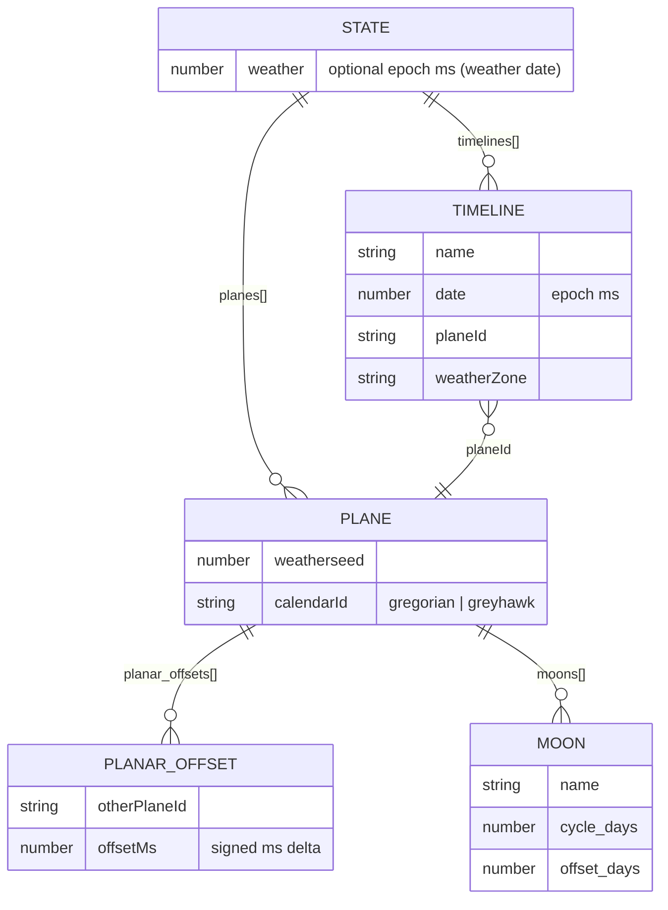

# Data Models

All persistence is flat files in the process working directory, named after the
Discord guild (`msg.guild.name`).

## 1. Guild configuration — `<Guild>.json`

Loaded by `getState`, written by `saveState`. Example:
[ServerNameHere.json](../../ServerNameHere.json).



### Schema

```jsonc
{
  "planes": {
    "<planeId>": {
      "weatherseed": 123,                 // number; seed for weather RNG
      "calendarId": "greyhawk",           // "gregorian" | "greyhawk"
      "planar_offsets": [                 // optional
        { "<otherPlaneId>": -29536707208000 },  // signed ms delta
        { "echt (MEZ)": -16473632400000 }        // special real-time anchor
      ],
      "moons": [                          // optional
        { "name": "Luna", "cycle_days": 28, "offset_days": 26 }
      ]
    },
    "echt (MEZ)": { "calendarId": "gregorian" }   // minimal real-time plane
  },
  "timelines": {
    "<categoryName>": {                   // key MUST equal a channel category name
      "name": "city of Oberstöckelskirchen",
      "date": 17662406400000,             // epoch ms, the live in-world date
      "planeId": "<planeId>",
      "weatherZone": "yourWeatherId"      // key into weather zone data
    }
  },
  "weather": 0                            // optional; epoch ms set by ~date weather
}
```

Notes:
- The **timeline key is the Discord channel category name**; this is how a
  message is mapped to a timeline (`channel.parent.name`).
- `planar_offsets` is an array of single-entry objects, not a map.
- `"echt (MEZ)"` offsets anchor a plane to real-world time and enable `~sync`.

## 2. Event log — `<Guild>_notes.json`

Loaded by `getNotes`, written by `saveNote`. A JSON array of strings kept sorted
by a date prefix. See [ServerNameHere_notes.json](../../ServerNameHere_notes.json).

Line format produced by `notesPrefix`:

```text
<sortableDatePrefixes>[<timelineName≤11>] # <free text>
```

- `<sortableDatePrefixes>` is a `|`-joined set of `sortableShort()` keys, one per
  plane, so that an entry sorts consistently across planes.
- Entries are inserted in order via `addNote`; `getNote` filters by prefix;
  `handleRemoveNotes` deletes the contiguous range matching the current prefix.

## 3. User roll cache — `<Guild>_users.json`

Loaded by `getUsers`, written by `saveUserfile`. See
[ServerNameHere_users.json](../../ServerNameHere_users.json).

```jsonc
{
  "<discordUsername>": {
    "srt": [15, 14, 12, 10, 9, 7]   // cached 4d6-drop-lowest roll, consumed by ~rollHero
  }
}
```

The `srt` array is set by `~rollAttributes` and cleared after `~rollHero`
consumes it.

## 4. Weather zone data — `yourWeatherHere.json`

Loaded statically by `weather.js` into `Weather.zones["yourWeatherId"]`. See
[yourWeatherHere.json](../../yourWeatherHere.json).

```jsonc
{
  "zone": "...",
  "seasons": [                     // thresholds as MMDD integers, matched descending
    { "Herbst": 1307 },
    { "Sommer": 507 },
    { "Hoher Sommer": 907 },
    { "Frühling": 228 },
    { "Winter": 1528 }
  ],
  "Frühling": [ "Temperatur ...", "..." ],   // array of weather description strings
  "Sommer":   [ "..." ],
  "Hoher Sommer": [ "..." ],
  "Herbst":   [ "..." ],
  "Winter":   [ "..." ]
}
```

- `getSeason()` builds `MMDD` from the date and returns the first season whose
  threshold is below it (seasons sorted descending by threshold).
- The computed weather index `0..31` selects a string via
  `index % season_array.length`.

## 5. Other data files

| File | Role |
| --- | --- |
| `wetter.json` | Sample/alternate weather zone data (not wired into `Weather.zones`) |
| `greyhawk.js` month/day name tables | Hardcoded in code, not external data |
| `images/*.svg` | Terrain tile artwork referenced by `mapsymbols.js` |

## 6. Assumptions

- `UNKNOWN:` the `weather` top-level field on state is only partially supported;
  the setters (`handleAbsoluteWeather`/`handleRelativeWeather`) contain defects
  (see technical spec §10.4), so the schema field is documented as present but
  not reliably writable.
- `UNKNOWN:` only one weather zone id (`yourWeatherId`) is registered in code,
  though `weatherZone` is per-timeline and implies multi-zone support.
