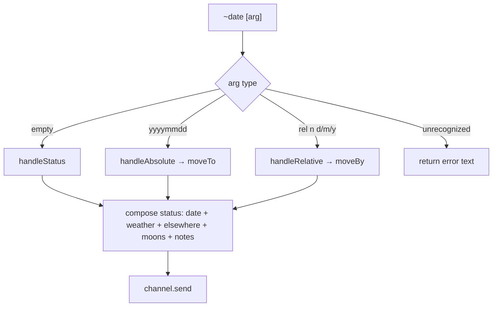
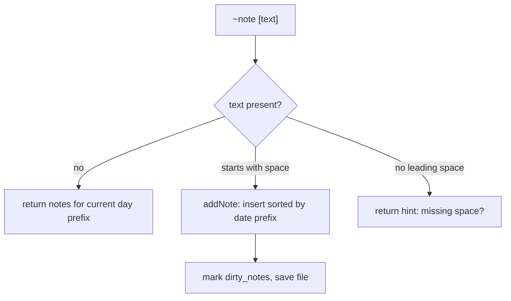
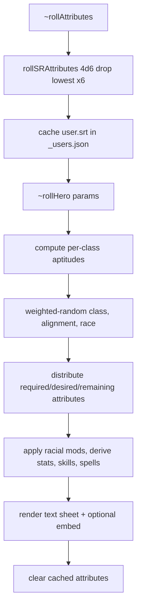

# Functional Specification

## 1. Purpose

Provide a Discord-based game-master toolkit that keeps multiple campaign
timelines in sync, reports in-world date, weather, and moon phases, maintains a
dated event journal, draws small hex maps, and generates random player
characters.

## 2. Actors

| Actor | Description |
| --- | --- |
| Game Master / Player | Any non-bot Discord user who types `~`-prefixed commands |
| Bot | The `wettergoblin` process responding in-channel |

## 3. Feature requirements

| ID | Requirement |
| --- | --- |
| FR-1 | The bot reacts only to messages beginning with `~` and ignores bot authors. |
| FR-2 | Dated commands resolve the active timeline from the channel's category name. |
| FR-3 | `~date` reports date, weather, cross-plane dates, moon phases, and notes. |
| FR-4 | `~date <yyyymmdd>` sets the timeline to an absolute in-world date. |
| FR-5 | `~date [+-]n{d,m,y}` moves the timeline relative to its current date. |
| FR-6 | `~sync` sets the timeline to the current real-world time via the `echt (MEZ)` offset. |
| FR-7 | `~note <text>` appends a dated entry to the guild event log. |
| FR-8 | `~allnotes` returns the full event log as a `.txt` attachment. |
| FR-9 | `~removenotes` deletes all entries for the current day/timeline. |
| FR-10 | `~timelines` renders an ASCII overview of all timelines and their relative offsets. |
| FR-11 | `~drawHex <params>` returns a procedurally generated hex map as an `.svg` attachment. |
| FR-12 | `~rollAttributes` rolls 4d6-drop-lowest six times and caches the result per user. |
| FR-13 | `~rollHero <params>` generates a full character sheet (`.txt`, optional embed) using cached attributes. |
| FR-14 | `~help` returns an embed describing available commands. |
| FR-15 | Mutations are persisted to per-guild JSON files immediately after handling. |
| FR-16 | Any handler error is caught and reported back to the channel. |

## 4. Use cases

| ID | Actor | Scenario | Expected outcome |
| --- | --- | --- | --- |
| UC-1 | GM | Types `~date` in a timeline channel | Status block with date, weather, moons, notes |
| UC-2 | GM | Types `~date 05781410` | Timeline set to year 578, month 14, day 10; status returned |
| UC-3 | GM | Types `~date +3d` | Timeline advanced 3 days; status returned |
| UC-4 | GM | Types `~date -1y 2m` | Timeline moved back 1 year, forward 2 months |
| UC-5 | GM | Types `~sync` | Timeline set to current real time (if plane has `echt (MEZ)` offset) |
| UC-6 | GM | Types `~note the dragon awakens` | Entry added under current date; `... added` |
| UC-7 | GM | Types `~note` (no text) | Returns existing notes for the current day |
| UC-8 | GM | Types `~allnotes` | `Ereignisse.txt` attachment with all entries |
| UC-9 | GM | Types `~removenotes` | Deletes today's entries; reports count |
| UC-10 | GM | Types `~timelines` | ASCII timeline chart with relative day offsets |
| UC-11 | Player | Types `~drawHex river14 mounts6 woods4` | `map.svg` attachment |
| UC-12 | Player | Types `~rollAttributes` | Embed with six attribute values, cached |
| UC-13 | Player | Types `~rollHero fighter\|thief xp12000 -verbose` | `char.txt` attachment plus embed sheet |
| UC-14 | User | Types an unknown `~xyz` | No reply (no matching branch) |
| UC-15 | User | Types command in a channel with no matching category | Error message `no timeline found [...]` |

## 5. Primary workflows

### 5.1 Date / status workflow

### 5.2 Note workflow

### 5.3 Character generation workflow

## 6. Input formats

| Input | Pattern | Meaning |
| --- | --- | --- |
| Absolute date | `^(\d{4})[.\-/ ]?(\d{2})[.\-/ ]?(\d{2})$` | year, month, day |
| Relative date | `^([+-]?\d+)y?\s*([+-]?\d+)m?\s*([+-]?\d+)d?$` | year/month/day deltas |
| Hex map params | space-separated keywords | `riverAB`, `roadAB`, `mountsNN`, `hillsNN`, `bogsNN`, `woodsNN`, `seed`, `nocoords`, `cubecoords` |
| Character params | space-separated keywords | `<class>` (`\|`-joined for multiclass), `<species>`, `xp<number>`, `seed`, `name`, `-verbose` |

## 7. Edge cases and error handling

- Month or day `00` in an absolute date is rejected with a validation message.
- Negative years are not supported in absolute mode; relative moves must be used.
- Missing guild config → thrown error `no configuration found for [guild]`.
- Channel without a matching timeline category → `no timeline found`.
- Plane referenced by a timeline but absent → `no plane found`.
- `~sync` without an `echt (MEZ)` planar offset → `keinen Bezug zum 'echten' Datum gefunden`.
- Any uncaught exception in a handler is caught in the `MessageCreate` listener,
  logged to console, and echoed to the channel as `that didn't work! [message]`.

## 8. Acceptance criteria

- AC-1: Each command in [api/commands.md](../api/commands.md) produces the
  documented reply type (text, embed, or attachment).
- AC-2: Weather output for a given `(seed, zone, date)` is reproducible across runs.
- AC-3: Setting a date and re-reading status shows the newly set date.
- AC-4: Notes persist across process restarts (reloaded from `<guild>_notes.json`).
- AC-5: Cached roll attributes are consumed by the next `~rollHero` and cleared.

## 9. Assumptions

- `UNKNOWN:` there is no automated test suite (`npm test` is a stub that exits 1);
  acceptance is defined behaviorally, not by existing tests.
- German is the intended primary output language; mixed English strings are
  treated as existing behavior, not defects.
