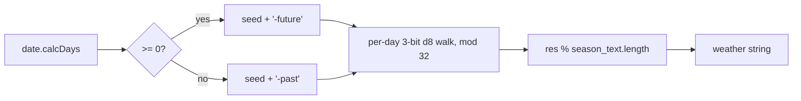

# Technical Specification

## 1. Technology stack

| Concern | Technology | Version |
| --- | --- | --- |
| Runtime | Node.js | not pinned |
| Discord API | discord.js | ^14.15.2 |
| Deterministic RNG | seedrandom | ^3.0.5 |
| SVG generation | @svgdotjs/svg.js | ^3.1.2 |
| Headless DOM for SVG | svgdom | ^0.1.14 |
| SVG→PNG (dead code) | svg2img | ^1.0.0-beta.2 |

Entry point: [index.js](../../index.js). No build step; executed directly.

## 2. Command router

[index.js](../../index.js) registers a single `Events.MessageCreate` listener.
Routing is an ordered `if/else if` chain on `msg.content.trim()`:

| Prefix match | Handler |
| --- | --- |
| `~date weather` | `handleDateWeather` |
| `~date` | `handleDate` |
| `~note` | `handleNote` |
| `~allnotes` | `handleSummary` |
| `~help` | `handleHelp` |
| `~drawHex` | `handleHex` |
| `~drawHexImage` | `handleHexImage` (no-op, body commented out) |
| `~removenotes` | `handleRemoveNotes` |
| `~timelines` | `handleTimelines` |
| `~sync` | `handleSync` |
| `~rollAttributes` | `handleRollAttributes` |
| `~rollHero` | `handleRollHero` |
| `~testCharCreation` | `testCharCreation` |

Order matters: `~date weather` is tested before `~date` so the longer prefix
wins.

## 3. State management

In-memory globals in [index.js](../../index.js):

```text
states  : { [guildName]: parsed <guild>.json }
notes   : { [guildName]: string[] }          // sorted, prefixed event lines
users   : parsed <guild>_users.json           // single object, not keyed by guild
buffers : {}                                  // declared, unused
dirty, dirty_notes, dirty_users : boolean     // write-back flags
```

- `getState(name)` lazy-loads and caches; throws if the file is absent.
- `getDirtyState / getDirtyNotes / getDirtyUsers` set the matching flag then
  delegate to the loader.
- After each handled message the listener calls `saveState` / `saveNote` /
  `saveUserfile` for whichever flags are set.

## 4. Calendar subsystem

`Calendar.create(id, ms)` ([calendar.js](../../calendar.js)) is a factory:

- `id === "gregorian"` → `Gregorian` wrapping a JS `Date`.
- `id === "greyhawk"` → `Greyhawk` with custom math.

### 4.1 Gregorian

Thin adapter over `Date`. `calcDays()` returns whole days since epoch; `moveTo`
builds a UTC date string, `getMs` returns `Date.getTime()`.

### 4.2 Greyhawk (custom calendar)

- `MSPERDAY = 86_400_000`; year = **364 days**.
- 16 month-names including four 7-day festivals (`Needfest`, `Growfest`,
  `Richfest`, `Brewfest`) interleaved with four 28-day months per season.
- 4 seasons of 91 days; `getSeason`, `getMonthOfSeason`, `getDayOfMonth`,
  `getMonthNr`, `getFullYear` derive fields from the raw millisecond count.
- 7 weekday names (`Starday`…`Freeday`).
- `moveBy(years, months, days)` performs season/festival-aware arithmetic.
- Output formats: `toString()` (German prose + bracketed `[yyyy-mm-dd]`),
  `short()`, `sortableShort()` (sign-prefixed zero-padded key for note sorting).

## 5. Weather algorithm

[weather.js](../../weather.js), `curValue()` — deterministic seeded random walk:

1. Compute `reqDays = date.calcDays()`; sign determines the seed suffix
   (`-future` / `-past`), so past and future are independent sequences.
2. Seed `seedrandom(seed + suffix)`; draw three 64-bit floats into a 24-byte
   `ArrayBuffer` viewed simultaneously as `Float64Array` and `Uint32Array`.
3. Walk one step per day: take the top 3 bits of word 0 as a d8 roll; map
   `>6 → -1`, `>4 → +1`, else `0`; accumulate into `res` modulo 32.
4. Shift the whole 192-bit buffer left by 3 bits each iteration; refill with
   three fresh floats every 64 days.
5. Final `res` (0–31) indexes into the season's text array (modulo its length).

`weatherText()` picks the season via `getSeason()` (comparing a `MMDD` integer
against descending season thresholds in the zone JSON) and formats:
`es ist <season>. <text>`.

Complexity: `O(reqDays)` per weather lookup — linear in the distance from epoch.



## 6. Moon phases

[moon.js](../../moon.js): `icon(days)` computes
`pos = (days + offset_days) mod cycle_days`, divides the cycle into 8 equal
phases, and returns the matching Discord moon emoji from `Moon.emojis`.

## 7. Hex map generation

[battlemap.js](../../battlemap.js) builds a fixed 5×5 `Hex` grid (odd-q layout
with four corner cells nulled). Construction:

1. `parseParams` tokenizes the command, keeping only known keywords
   (`Battlemap.keywords`).
2. `seed` param → deterministic `seedrandom`; otherwise random.
3. `fillMap` places rivers, roads, then terrain (`mounts`, `hills`, `bogs`,
   `woods`) via `placeTerrain` using per-type probability maps.
4. `drawMap` renders hexes, optional coordinate labels, and roads/rivers into an
   SVG string returned to the caller.

[hex.js](../../hex.js) provides cube ↔ offset conversion, `distance`,
`neighbors`, `sharpTurns`/`allTurns` (path-routing helpers), and `tileType`
selection from elevation/vegetation.

[mapsymbols.js](../../mapsymbols.js) defines per-tile fills and radial gradients
and lazily loads terrain icons (`images/berg7.svg`, `huegel3.svg`, `bogs3.svg`,
`baum2.svg`) into the SVG `<defs>`.

## 8. Character generator

[character.js](../../character.js) implements AD&D-1e-style generation:

1. `rollSRAttributes` / `rollAttribute`: **4d6 drop lowest**, six values.
2. Per class in `Def.ALLCLASSES`, compute `classAptitude` (requirements +
   racial mods + XP-bonus aptitude).
3. Build a weighted `Table` of viable classes; roll class (or honor `class`
   param, multiclass joined by `|`).
4. Roll alignment and race from weighted tables derived from the class.
5. `distributeRequired` / `distributeDesired` / `distributeRemaining` assign the
   six rolled values to STR/DEX/CON/INT/WIS/CHA respecting class minimums.
6. `applyRacialMods`, `setStats(xp)`, `setSkills` (thief/assassin/monk skill
   table with racial adjustments), spell assignment.
7. Output via `toTextSheet()` (header, attributes, racial abilities, saves,
   weapons, armor, skills, and up to four spell blocks) and `toEmbedSheet()`.

Rules data lives in [defines.js](../../defines.js) (`clazzRequirements`,
`bonusXPRequirements`, `HITDICE`, `raceMods`, `racesForClass`,
`multiclassRequirements`) and spell lists in [spells.js](../../spells.js).

`Table` ([table.js](../../table.js)) is a weighted random picker: cumulative sum
over a `Map<key, weight>`; `roll()` returns a key, `rollIdx()` an index,
`rollDie(sides)` a 1..sides integer, `multiply(mod)` scales weights.

### 8.1 Magic item generation (`~rollHero`)

Magic items are produced inside `setStats(xp)` ([character.js](../../character.js#L1068))
by five generators. `xp` comes only from the `xp<number>` command parameter and
**defaults to 0**. Four generators start with `if (this.xp < 1) return;`, so with
no `xp` parameter a character receives **no potions, magic weapon, magic armor,
or misc items** (misc count is forced to 0 at level 1). **Scrolls are the only
magic item that can appear without an `xp` parameter.**

Primitives: `Table.rollDie(n)` is uniform `1..n`; `Table.roll()` picks a key with
probability `weight / Σweight`; `classLevel(clz)` returns 1–10 from the XP
thresholds in [defines.js](../../defines.js).

#### Potions — `setPotions` (gated xp ≥ 1)

`rollDie(100) < factor × level` → present with probability ≈ `factor × level %`
(capped at 100%). If present, `1..maxCount` potions (uniform), each an even 1/10
from `Def.ITEMS_POTIONS`.

| Class | factor | maxCount |
| --- | --- | --- |
| Druid | 11 | 2 |
| Magic-user | 10 | 3 |
| Illusionist | 10 | 2 |
| Thief | 9 | 2 |
| Fighter | 8 | 1 |
| Ranger | 7 | 1 |
| Cleric / Paladin | 6 | 1 |
| Assassin | 5 | 1 |
| Monk | 0 | never |

#### Scrolls — `setScrolls` (no xp guard)

`rollDie(100) < factor × level` → `factor × level %`. If present: `1..3` scrolls
(uniform) for MU/Illusionist/Cleric, exactly 1 for all other classes.

| Class | factor | Content |
| --- | --- | --- |
| Magic-user | 15 | random MU spell, level `rollDie(6)`, uniform within level |
| Illusionist | 12 | random IL spell, level `rollDie(4)` |
| Cleric | 8 | random CL spell, level `rollDie(4)` |
| Druid | 7 | protection scroll, uniform 1/7 (`Def.ITEMS_PROTSC`) |
| Fighter / Thief | 6 | protection scroll 1/7 |
| Ranger | 5 | protection scroll 1/7 |
| Paladin | 4 | protection scroll 1/7 |
| Assassin | 3 | protection scroll 1/7 |
| Monk | undefined | never (`< NaN` is always false) |

#### Miscellaneous items — `setMisc` (level-driven, no % roll)

`count = rollDie(sd) − 1` (uniform `0..sd−1`), `sd = 1 + floor((level − 3) / 2)`.
Each item is an even 1/18 (deduped) from the inline wondrous-item list.

| Level | sd | count range | avg |
| --- | --- | --- | --- |
| ≤ 4 | 1 | 0 | 0 |
| 5–6 | 2 | 0–1 | 0.5 |
| 7–8 | 3 | 0–2 | 1.0 |
| 9–10 | 4 | 0–3 | 1.5 |

Bug: `max_lvl` is computed with `Math.max(Char.clazzLevel(clz,char))` (single
argument, no accumulator), so it ends as the **last** class's level, not the
highest.

#### Magic weapon — `setMagicWeapon` (gated xp ≥ 1)

Picks one weapon from the class's weighted `Def.ITEMS_WPNS` list, then **reuses
the chosen weapon's weight as a base percent**: chance = `weight × level %`
(`rollDie(100) < weight × level`). Result is `+1`, or `+2` if
`dr < level + max(0, chance − 90)`. Multiclass considers **only the first class**.
Weight-averaged effective chance per level:

| Class | ≈ chance/level |
| --- | --- |
| Illusionist | 15% |
| Magic-user | 13% |
| Cleric | 12% |
| Thief | 11% |
| Paladin | 9.7% |
| Ranger | 9.4% |
| Druid | 9.2% |
| Fighter | 9.0% |
| Assassin | 6.7% |
| Monk | 4.1% |

#### Magic armor — `setMagicArmor` (gated xp ≥ 1)

Chance = `weight × level %`, where `weight` is the `Def.ITEMS_ARMR` entry for the
piece actually worn (or shield / bracers / ring of protection). `+1`/AC6, or
`+2`/AC4 if `dr < level + max(0, chance − 90)`. Representative weights:

| Class | item weights (chance = weight × level %) |
| --- | --- |
| Fighter / Paladin | chain 10, banded 8, plate 6, shield 10, ring o.prot 2 |
| Cleric | chain 8, banded 6, plate 5, shield 10, ring o.prot 2 |
| Ranger | chain 15, banded 7, plate 5, shield 8, ring o.prot 2 |
| Thief | leather 10, ring o.prot 4 |
| Assassin | shield 8, leather 10, ring o.prot 4 |
| Druid | leather 8, ring o.prot 5 |
| Magic-user / Illusionist | ring o.prot 15, bracers 5 |
| Monk | — (no entry → never) |

## 9. Dependency graph (internal)

| Module | Depends on |
| --- | --- |
| index.js | history, calendar, weather, battlemap, defines, character, greyhawk, moon |
| calendar.js | gregorian, greyhawk |
| weather.js | gregorian, yourWeatherHere.json |
| battlemap.js | hex, mapsymbols |
| mapsymbols.js | images/*.svg |
| character.js | defines, spells, table |
| defines.js | table |
| edgepath.js | hex |

No circular dependencies detected.

## 10. Known issues / technical debt

Severity-ordered. These are factual defects found in source.

1. **Hardcoded bot token placeholder** — [index.js](../../index.js#L95):
   `bot.login("<place the bot token here>")`. Non-functional as shipped and a
   secret-handling anti-pattern. Load from an environment variable instead.
2. **Pervasive implicit globals** — handlers assign to undeclared identifiers
   (`str`, `states`, `notes`, `users`, `res`, `clp`, `param`, `old`, `d`, `bm`,
   `buff`, `pa`). With a single shared process these leak across concurrent
   message handling and risk cross-request state corruption. Add `"use strict"`
   and declare all locals.
3. **`Gregorian.moveBy` references undefined `param`** —
   [gregorian.js](../../gregorian.js#L60) uses `param[1..3]` instead of its
   `years, months, days` arguments; relative moves on the gregorian calendar
   will throw `ReferenceError`.
4. **`handleAbsoluteWeather` / `handleRelativeWeather` reference undefined
   `param`** — [index.js](../../index.js#L591) uses `param[0]` though the
   argument is named `params`; the `~date weather <abs/rel>` branches throw.
5. **`history.js` is partially broken** — `getLines` calls `.foreach` (should be
   `forEach`), never initializes `res`, and `toDate` references an undefined
   `value`. The module's file-loading path is non-functional; only the regex
   helpers used elsewhere work.
6. **Weather lookup is O(days-from-epoch)** — far dates cause long loops.
7. **Dead / stub code** — `handleHexImage` body commented out; `edgepath.js` and
   `midgard.js` are stubs; `svg2img` imported but unused; several `test*`
   handlers remain wired.
8. **Guild name used directly as a file path** — no sanitization; a crafted
   guild name is a path-traversal risk for the JSON read/write.

## 11. Security assessment (OWASP-relevant)

- **Secrets in source (A02/A05):** token placeholder hardcoded; must move to env.
- **Path handling (A01/A03):** `getState`/`saveState` build file names from the
  Discord guild name without validation — treat as untrusted input and sanitize.
- **Input parsing:** command parsing is regex-bounded and does not evaluate user
  input, so no injection into code execution was found.
- **No rate limiting:** heavy commands (`~drawHex`, far-future `~date`) can be
  spammed; consider throttling.
- **DoS via weather loop:** extreme dates make `curValue()` loop proportionally;
  bound `reqDays` or memoize.

## 12. Assumptions

- `UNKNOWN:` intended Node version — not declared in `package.json` `engines`.
- `UNKNOWN:` whether defects #3–#5 are latent (unreachable in normal use) or
  actively hit; they are reachable through the documented command inputs.
